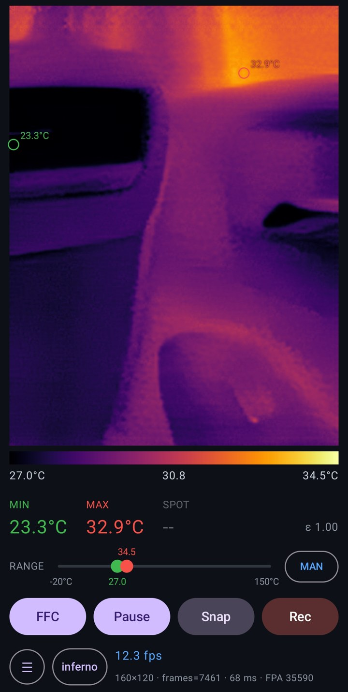

<div align="center">

# 🔥 MAG160 ThermalCam

### An open-source thermal imaging app for Android phones — one app for many thermal modules.

**English** · [繁體中文](README.zh-TW.md) · [简体中文](README.zh-CN.md)


</div>

<p align="center"></p>

---

## 🎯 Goal

**MAG160 ThermalCam** aims to be an **open-source thermal imaging app for phones** that works
with as many USB thermal camera modules as possible: plug a module into the phone you already
own, open one app, measure — with the same palettes, markers, super-resolution, recording and
fusion whichever module it is.

## 📷 Supported modules

| Module | Resolution | Status |
|---|---|---|
| Magnity **MAG160 / MAG-Mx / MAG-Cx** | 160×120 | ✅ Supported (factory SDK) |
| InfiRay **Tiny2C** (AC020) | 256×192 | ✅ Supported (vendor AC020 SDK) |
| Hikvision **TB-4117-3/S** (USB) | 160×120 | 🧪 Diagnostic support (2.8) |

## 🤝 Help add more modules

Every module speaks its own protocol. With the vendor's **Android SDK** or its **protocol
documentation**, support for a module can be added quickly; without them it has to be
reverse-engineered first, which takes far longer. If you make or sell a thermal module, or
have its SDK, documentation or a unit to test with, please [open an issue](https://github.com/delphicchen/MAG160_ThermalCam/issues) —
it is the most direct way to get another module supported.

## 😤 How it started

The Magnity **MAG-Mx / MAG-Cx** USB thermal camera (VID `0x833C`) is great hardware — but its
official apps **stopped working on Android 15+**. Plug it into a new phone and you get
nothing. So this app was rebuilt for it from the ground up by reverse-engineering the vendor
SDK, and grew from there to other modules.

## ✨ Android app features

| | |
|---|---|
| 📱 **Works on Android 15+** | Runs where the factory MAG-Cx / MAG-Mx apps no longer do. |
| 🌡️ **Real absolute temperature** | Straight from the factory SDK — fully corrected, no manual calibration. |
| 📷 **Several modules, one app** | Magnity MAG160 / MAG-Mx, InfiRay **Tiny2C** (256×192) and, in testing, Hikvision **TB-4117** — plug one in and MagViewer recognises it. |
| 🎯 **MIN / MAX / CTR / SPOT markers** | Find the hottest and coldest point instantly, read the centre crosshair, plus a live colour bar and a smoothly tracking auto range. |
| 🔍 **Detail enhancement (DDE)** | Optional commercial-camera look: local contrast and edges brought out, flat areas quieter — display only, readouts untouched. |
| 🎚️ **Adjustable emissivity** | Set ε from 0.10 to 1.00, with one-tap presets for skin, matte paint and wood. |
| 🚀 **4× AI super-resolution** | A thermal-tuned Real-ESRGAN model on the GPU via **ncnn + Vulkan** turns 160×120 into a crisp 640×480. |
| ✨ **Anime4K GPU upscaling** | Sharp, clean display with a real-time CNN shader. |
| 📸 **Snapshots** | One tap saves a PNG. |
| 🎬 **Video recording** | Hardware **HEVC/H.265** encoding with automatic H.264 fallback. |
| 🌡️ **Temperature captures** | Snapshots and recordings can also save a `.mgt` file holding every pixel's °C — reopen it in the app and read any position, in any frame. |
| 🔀 **Visible-light fusion (beta)** | Overlay the phone camera's edges on the thermal image (MSX-style), blend, or search in the wide visible view — with alignment calibrated at several distances, a calibration wizard that fits the alignment over several measured distances, auto distance from centre-weighted lens focus (with a crosshair showing the patch it measures), and calibration export/import. |
| 📍 **Optional geo-tag** | Stamp precise GPS location into snapshots and videos — off until you turn it on. |
| 🌐 **Interface language** | English, 繁體中文 or 简体中文, switched in the drawer (or follow the system). |
| 💾 **Remembers your setup** | Palette, range, rotation, upscaler, emissivity and more survive restarts. |
| 🚫 **No watermark** | Your images are yours. |
| 👍 **Compact portrait UI** | Designed for one-handed use in the field. |

## 🚀 Get started

1. **Download the APK** from [Releases](https://github.com/delphicchen/MAG160_ThermalCam/releases) (arm64, Android 10+ from 2.8; 2.7 needs Android 13+), or build it yourself:
   ```sh
   cd android2
   JAVA_HOME=/path/to/android-studio/jbr ./gradlew :app:assembleDebug
   ```
2. Connect the camera to your phone with a **USB-C OTG adapter**.
3. Open the app, accept the USB permission — you're streaming.

> **Note:** the vendor SDK (`libcoresdk.so` / the AAR files under `android2/lib/`) is **not**
> included in this repository. Supply it from your own copy of the vendor software.

## 🧰 Also in this repository

- **🐧 Linux desktop viewer** (`viewer.py`) — live 160×120 @ 15 fps in pure Python, bit-exact
  factory NUC, flat-field / bad-pixel / denoise pipeline, Planck-based °C readout.
  Quick start:
  ```bash
  pip install pyusb numpy pillow PySide6 matplotlib
  sudo cp 99-magnity-thermal.rules /etc/udev/rules.d/ && sudo udevadm control --reload-rules
  python3 viewer.py
  ```
- **🧠 Train your own thermal SR model** — a Colab pipeline in [`sr_train/`](sr_train/README.md).
- **🔬 Reverse-engineering notes** — the full USB protocol in [`PROTOCOL.md`](PROTOCOL.md) and
  the SDK / calibration write-up in
  [`android2/REVERSE_ENGINEERING.md`](android2/REVERSE_ENGINEERING.md).
- **`android/`** — an earlier Android port that runs the fully open, SDK-free pipeline.

## 🗒️ Changelog

Full notes and the APK for each version are in
[Releases](https://github.com/delphicchen/MAG160_ThermalCam/releases).

### 2.8 — 2026-10-27
- **Runs on Android 10 and later** (2.7 needed Android 13). HarmonyOS 2–4 may work (not
  tested); HarmonyOS NEXT / 5 does not install APKs. Before Android 13 the app follows the
  system language.
- **Thermal SR model size: Full / Medium / Lite** in the menu — Medium and Lite are built in
  and do a little over half / about a quarter of the network work per frame: a cooler phone
  and longer battery for a slightly softer picture. When Thermal SR cannot keep up, the app
  steps down one size at a time, then to Anime4K. **Load SR model (.zip)** files a model under
  its size by itself.
- **Minimum span (auto range)**, 1.0 °C by default, adjustable 0.2–3 °C in the menu with an
  explanation: a nearly uniform scene no longer stretches sensor noise into blotches and false
  texture. Recorded `.mgt` captures play back with the same range.
- **Hikvision TB-4117-3/S (USB) — diagnostic support**: a temperature image from the module's
  radiometric snapshot (a few frames per second) and a **Run stream test** report to send back.
- MAG160 USB permission on Android 10–12 fixed; geo-tag on Android 10 no longer crashes when
  location is toggled. The Debug overlay shows the app's CPU load and, where the phone exposes
  it, the GPU load.

### 2.7 — 2026-10-23
- **InfiRay Tiny2C support** (AC020 UVC, 256×192) next to the MAG160 in the same app, through
  the vendor's AC020 Android SDK 1.1.5: temperature, FFC and emissivity. For a UVC camera
  Android needs the **Camera** permission before USB access — allow both. Not done yet: the
  vendor's 30 s warm-up compensation and high/low gain switching (fixed high gain, −15…150 °C).
- **Thermal SR at any frame size** — the built-in model also runs on the Tiny2C. When it cannot
  keep up with the camera (under ~⅔ of its frame rate), MagViewer switches to Anime4K once and
  says why; pick Thermal SR again to keep it.
- **Detail enhancement (DDE)** in the drawer — local contrast and edges brought out, flat areas
  quieter. Display only; while it is on, colours no longer scale linearly with °C.
- **CTR** — a centre crosshair with its temperature (mean of the centre pixels), as a readout and
  in snapshots and videos. Tap CTR under the image to hide it.
- **Steadier auto range** — the colour range glides (~0.4 s) instead of jumping every frame, so
  the picture no longer pulses when something warm enters or leaves.
- **MAG-Mx calibration download retries** — when the first-connection download breaks off
  (error −2: the USB transfer failed, typical of thin 4-pin cables or weak OTG power), MagViewer
  relinks and tries twice more, and the error says how far it got. Once a download succeeds it
  is cached for good.
- Debug overlay shows what drew each frame (path, size, change per frame, Tiny2C SDK counters);
  the Simplified Chinese UI uses Chinese palette and upscaler names.

### 2.6 — 2026-10-12
- **Calibration wizard** — a guided fusion calibration: one far point, then 1 m, 0.5 m and
  0.3 m. Enter the measured distance first and X/Y start where the fitted line predicts, so
  only a nudge is left; ZOOM is worked out from the phone's lens data. The summary marks any
  point more than 3 px off the line for a redo, and the old calibration is replaced only when
  you finish.
- **Steadier close-range fusion** — with three or more calibrated distances the overlay follows
  the best-fit line in 1/Z instead of passing through every saved point, so one badly aligned
  point no longer bends the whole curve. Existing calibrations get this too.
- A lens focus reading that contradicts the other points (some lenses misread very close or
  plain targets) is left out of the autofocus distance map.
- Focus diagnostics in the drawer: AF state, the AF regions the camera actually uses (drawn on
  the image) and the active physical lens; a debug button saves 10-frame fusion bursts.

### 2.5.2 — 2026-10-10
- **First connection fixed** — on a phone that had never linked that camera, connecting
  failed with `startProcessImage failed`: the app started streaming while the camera's
  calibration file (~1.8 MB) was still downloading. It now waits for the download and
  shows its progress in the status line.

### 2.5.1 — 2026-09-29
- **Crash fixes** — no more crash when unplugging the camera mid-stream (the SDK and the app
  could release the same USB link twice), on launch with the camera already attached, or
  from a quick unplug/replug starting a new connection before the old one was closed.
- Picture no longer smears for ~2 s after a shutter (FFC) or a fast pan.

### 2.5 — 2026-09-27
- **Interface language** — English, 繁體中文 or 简体中文, picked in the drawer or under
  Android's per-app language settings; *System* follows the phone. Switching is instant and
  keeps the camera connected. Measurement and product terms (MIN / MAX / CTR / SPOT, FFC, ε,
  Thermal SR, Anime4K, MSX…) stay in English in every language.

### 2.4 — 2026-09-26
- **New built-in Thermal SR model (v4)** — trained on a °C sensor view with L1 + spectrum +
  gradient loss and no GAN (2.3 shipped a GAN-trained model). On 38 real MAG160 frames it
  invents fewer hot spots than the previous v3 training run (5.0 vs 5.9 per frame), and the
  worst one is far weaker (52 vs 129 levels).
- **Load SR model (.zip)…** in the drawer imports a trained model package without
  rebuilding the app; *Use built-in* goes back. The status line says which one is running.
- Runs both 1-channel and 3-channel SR models; faster native glue, frame timing moved to a
  Debug overlay.
- Faster visible-light fusion: table-driven, parallel, one frame copy.

### 2.3 — 2026-09-24
- **Temperature captures** — snapshots and recordings can also write a `.mgt` file holding
  every pixel's °C; *Open temperature capture…* replays it: scrub the frames, tap any
  position to read it ([format](android2/docs/THERMAL_CAPTURE.md)).
- **Fusion crosshair** over the visible camera's AF window — the patch the Auto object
  distance is measured on.
- Leaving the calibrated distances now **offers an Align button** instead of opening the
  alignment panel by itself, and the range test allows ±0.5 m instead of a fixed step in 1/Z.
- Alignment is **interpolated between the saved distances**; centre-weighted AF, focus-driven
  auto distance, calibration export/import, and a thermal-aware gate for the edge overlay.

### 2.2 — 2026-09-18
- **Visible-light fusion (beta)** — MSX edges, Blend and Wide search, with the alignment
  calibrated at several distances and object distance from auto focus / manual / ∞.
- Bilateral denoise 4.7× faster; spatial denoise switches off while Thermal SR is on.

### 2.1 — 2026-09-17
- **4× AI super-resolution** — a thermal-tuned Real-ESRGAN model bundled in the APK, run on
  the GPU with ncnn + Vulkan.
- Adjustable emissivity, optional geo-tag, and settings that survive restarts.

### 2.0 — 2026-09-16
- First release: live 15 fps absolute temperature, MIN / MAX / SPOT, colour bar with auto or
  manual range, snapshots and HEVC recording, Anime4K GPU upscaling, 8 palettes, rotation /
  mirror, temporal + spatial denoise and on-demand FFC.

## 📜 Licence

**Free for noncommercial use** — personal, research, educational and hobby use. Commercial use
needs a separate written licence; see [`LICENSE`](LICENSE). Third-party components keep their
own terms ([`android2/THIRD_PARTY_NOTICES.md`](android2/THIRD_PARTY_NOTICES.md)). The Magnity /
Elo SDK is proprietary and is neither licensed nor redistributed here.

Temperature readings are informational only; this is not a calibrated instrument.

## ⭐ Brought your camera back to life?

**Give the repository a star** — it's how I decide whether to keep polishing it.
Issues and pull requests are welcome.

---

## 🔗 友鏈

**友鏈:** [https://linux.do](https://linux.do)

非常感谢 LINUX DO 社区提供的交流平台 / Many thanks to the LINUX DO community for the great discussion platform.
